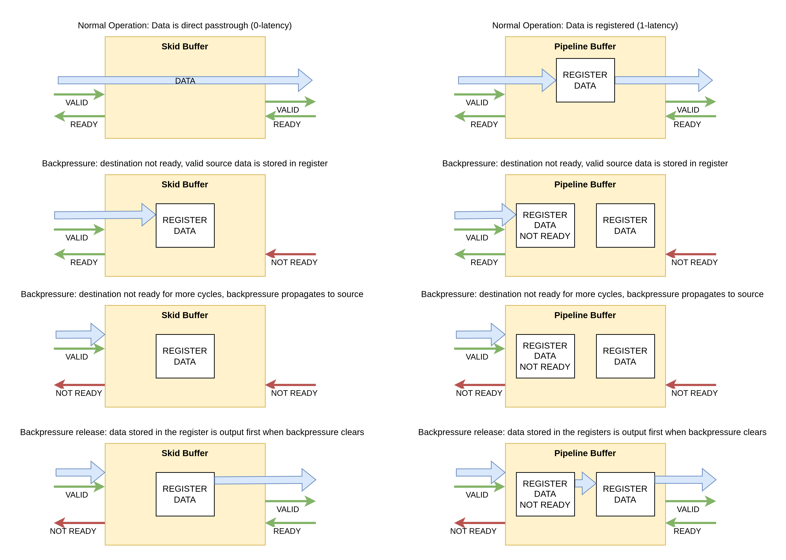

<!--
SPDX-FileCopyrightText: 2026 CERN

SPDX-License-Identifier: CERN-OHL-W-2.0
-->

# Common Packages and Entities

This directory contains different entities and packages that aim to collect the most used functions.

### Packages

- `utils` Collection of bit-math, registers, bit/byte manipulation.

- `encoders` classic encodings helper function (i.e. gray, one-hot).

- `types` Collection of custom type definitions.

- `poly` Collection of common polynomials.

### Entities

- `counter` a simple counter module.

- `comparator` a simple comparator with enable signal.


- `synchro` a general purpose Clock Domain Crossing (CDC) circuit (`std_logic_vector` version)

- `synchro_generic` a generic type Clock Domain Crossing (CDC) circuit (Requires [Tool Support](#vhdl-2008-support))

- `synchro_reset` reset signal synchronizer

- `synchro_pulse` synchronizes fast (and slow) pulses over clock domain boundaries
  
- `synchro_handshake` synchronizes streams over clock domain boundaries with backpressure propagation

- `stream_buffer` an elastic buffer for simple streams to store data when backpressure is applied (it allows both *skid* and *pipeline* behaviour using `g_REGISTER_DATAPATH` generic).
- `stream_buffer_generic` equivalent of the `stream_buffer` component with generic types (Requires [Tool Support](#vhdl-2008-support))


### Legacy components / soon to be removed

- `skid_buffer` an elastic buffer to store data when backpressure is applied (low latency).

- `pipeline_buffer` a fully decoupled two-stage FIFO to improve pipelining.

### How to use

Compile everything in the `colibri` library.  
If VHDL-2008 is supported, library instantiation can be done using contexts:
```vhdl
library colibri;
context colibri.common;
```

### Skid buffers and Pipeline Buffers
Skid and Pipeline buffers are interchangeable components used to connect entities working with back-pressure sensitive streams.
These components reduce the combinational path between components by registering part or all signals, easing timing, while not losing any data when back-pressure is asserted.
These buffers are implemented in [stream_buffer](/src/common/stream_buffer.vhdl) and [stream_buffer_generic](/src/common/stream_buffer_generic.vhdl). Both behaviours are configurable using the `g_REGISTER_DATAPATH` generic.

In `skid` mode the data path is direct under normal operation. There is no latency between source and destination.
- When back-pressure is asserted, the in-flight data is stored in a register, allowing the registered `ready` signal to toggle.
- If back-pressure is longer than one clock-cycle, it is propagated to the source using the registered `ready` signal.
- When back-pressure is released, the registered data is output first keeping the source not ready, then normal operation is restored.

In `pipeline` mode the mechanism is almost identical to the skid buffer, except that data is always registered, hence the minimum latency is 1 clock cycle. This component can also be seen as a two-word FIFO.
Pipeline buffers use more resources, but they completely decouple source and destination and can lead to better performance overall.




### VHDL 2008 support

Unfortunately some tools do not yet support VHDL-2008 features (sigh!) -> colibri/colibri#13  
Avoid `common`, `synchro_generic`, and `stream_buffer_generic` in this case.

### Development status and testing

| entity              | simulation | self-checking tb | formal verification |
| ------------------- | ---------- | ---------------- | ------------------- |
| `utils`             | ❌          | ❌                | 🟡                   |
| `encoders`          | ❌          | ❌                | ❌                   |
| `types`             | ❌          | ❌                | ❌                   |
| `counter`           | ❌          | ❌                | ✅                   |
| `comparator`        | ✅          | ✅                | ❌                   |
| `edge_detect`       | ✅          | ✅                | ✅                   |
| `synchro`           | ✅          | ✅                | ❌                   |
| `synchro_generic`   | ✅          | ✅                | ❌                   |
| `synchro_reset`     | ✅          | ✅                | ❌                   |
| `synchro_pulse`     | ✅          | ✅                | ❌                   |
| `synchro_handshake` | ✅          | ✅                | ❌                   |
| `stream_buffer`     | ✅          | ✅                | ✅                   |
| `stream_buffer_generic`     | ✅          | ✅                | ❌                   |
| `debouncer`         | ❌          | ❌                | ✅                   |
| `skid_buffer`       | ❌          | ❌                | ✅                   |
| `pipeline_buffer`   | ❌          | ❌                | ✅                   |
