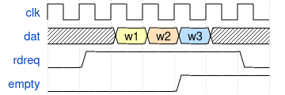
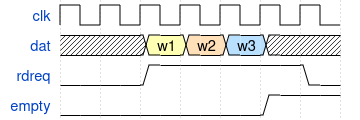

<!--
SPDX-FileCopyrightText: 2026 CERN

SPDX-License-Identifier: CERN-OHL-W-2.0
-->

# Memory Entities

This directory contains different entities that instantiate memories.

### Entities

- `fifo` single clock synchronous FIFO for any-to-any data width.
- `cc_fifo` dual clock asynchronous FIFO for any-to-any data width.
- `cc_ram_fifo` dual clock asynchronous RAM-based FIFO with asymmetric RAM ports support (check [Optimized Versions](#optimized-versions) for more info on synthesis).
- `packet_fifo` single clock synchronous AvalonST Packet FIFO.
- `packet_cc_fifo` dual clock asynchronous AvalonST Packet FIFO (*legacy implementation*).  
- `packet_cc_ram_fifo` dual clock asynchronous AvalonST Packet FIFO with mixed data widths and write-side packet drop. Optimized for resource usage using RAM primitives. (check [Optimized Versions](#optimized-versions) for more info on synthesis).
- `bicam` binary content addressable memory.  
- `rom` read-only memory
- `ram` single port, single clock synchronous RAM.
- `simple_dpram` single write port, single read port, dual clock RAM with support for asymmetric ports (check [Optimized Versions](#optimized-versions) for more info on synthesis).
- `simple_dpram_be` single write port with byte-enable vector, single read port, dual clock RAM.
- `true_dpram` dual write port, dual read port, dual clock RAM with support for asymmetric ports. (check [Optimized Versions](#optimized-versions) for more info on synthesis).
- `ring_buffer` circular buffer with lossy write (oldest element is dropped when full).

### Usage Notes:

All FIFOs support **First Word Fall Through** mode, also known as **Lookahead** in Altera primitives. In this mode, the `rdreq` signal acts as an acknowledge and the `empty` as a  not valid.
#### Normal Behaviour (`g_ENABLE_FWFT = false`)

#### First Word Fall Through Behaviour (`g_ENABLE_FWFT = true`)

## Features
Pakcet RAM FIFO has packet size calculation active by default. Size is used as synchronization mechanism between write-side and read-side.

Packet FIFOs support packet size calculation `g_ENABLE_SIZE_COUNT`.

## Optimized Versions
Optimized entities are available in the [optimized](optimized) subdirectory.
These entities are developed using the coding guidelines from the vendors (specified in the name).
This was required to allow correct recognition and synthesis of hardware primitives, since it was not possible to find a common coding that all vendors agreed on. By **default** the optimized entity will be *automatically* selected by compiler. A specific version can be forced using the `g_IMPL_STYLE` directory.

Note that these versions are **STILL VENDOR AGNOSTIC**, meaning no license or proprietary tool is required to simulate their behaviour. Nothing stops you from trying to synthesize a vendor-1 version using vendor-2 compiler. These versions are there to guarantee the correct primitive implementation.

### Development status and testing

| entity               | simulation | self-checking tb | formal verification |
| -------------------- | ---------- | ---------------- | ------------------- |
| `fifo`               | ✅          | ✅                | ✅                   |
| `cc_fifo`            | ✅          | ✅                | ❌                   |
| `cc_ram_fifo`        | ✅          | ✅                | ❌                   |
| `packet_fifo`        | ✅          | ✅                | ❌                   |
| `packet_cc_fifo`     | ✅          | ✅                | ❌                   |
| `packet_cc_ram_fifo` | ✅          | ✅                | ❌                   |
| `bicam`              | ✅          | ✅                | ❌                   |
| `rom`                | ✅          | ✅                | ❌                   |
| `ram`                | ✅          | ✅                | ❌                   |
| `simple_dpram`       | ✅          | ✅                | ❌                   |
| `simple_dpram_be`    | ✅          | ✅                | ❌                   |
| `true_dpram`         | ✅          | ✅                | ❌                   |
| `ring_buffer`        | ✅          | ✅                | ✅                   |

### Notes on Resource Efficiency
The `cc_ram_fifo` component can reduce significantly the use of resources when using a mixed width configuration. The tool will avoid generating a gearbox in logic and instead use the hardware RAM ports.
Please note that the RAM is coding-style dependent, check [Optimized Versions](#optimized-versions).

An example resource scan in Xilinx Vivado 2024.1 shows up to 6x less LUTs and 5x less FFs versus the more generic `cc_fifo` component:

| Entity      | INPUT_WIDTH | OUTPUT_WIDTH | LUTs | FFs | BRAMs | DSPs |
| ----------- | ----------- | ------------ | ---- | --- | ----- | ---- |
| cc_fifo     | 4           | 32           | 285  | 198 | 0     | 0    |
| cc_ram_fifo | 4           | 32           | 40   | 48  | 0.5   | 0    |
| cc_fifo     | 8           | 32           | 240  | 201 | 0     | 0    |
| cc_ram_fifo | 8           | 32           | 39   | 44  | 0.5   | 0    |
| cc_fifo     | 32          | 32           | 68   | 68  | 0     | 0    |
| cc_ram_fifo | 32          | 32           | 68   | 68  | 0     | 0    |